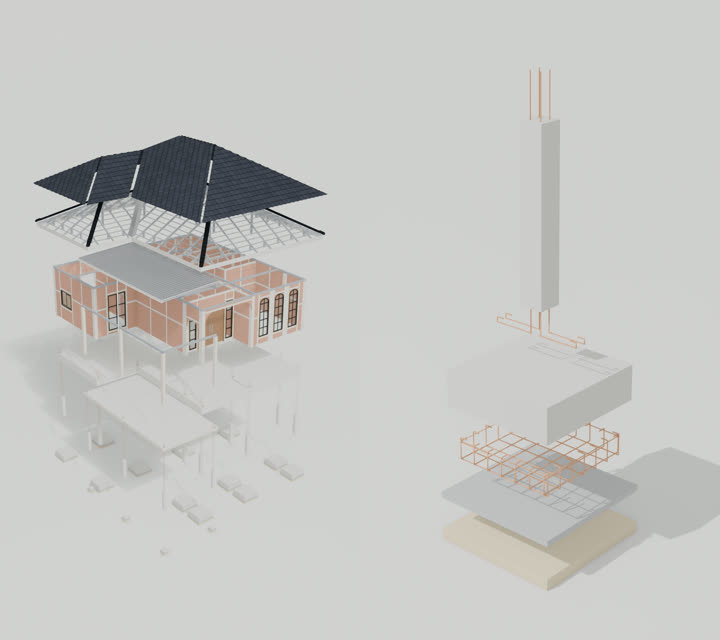
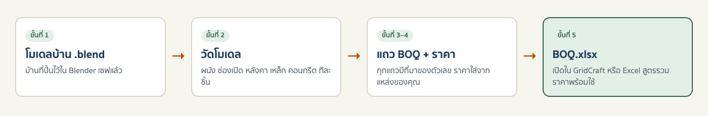
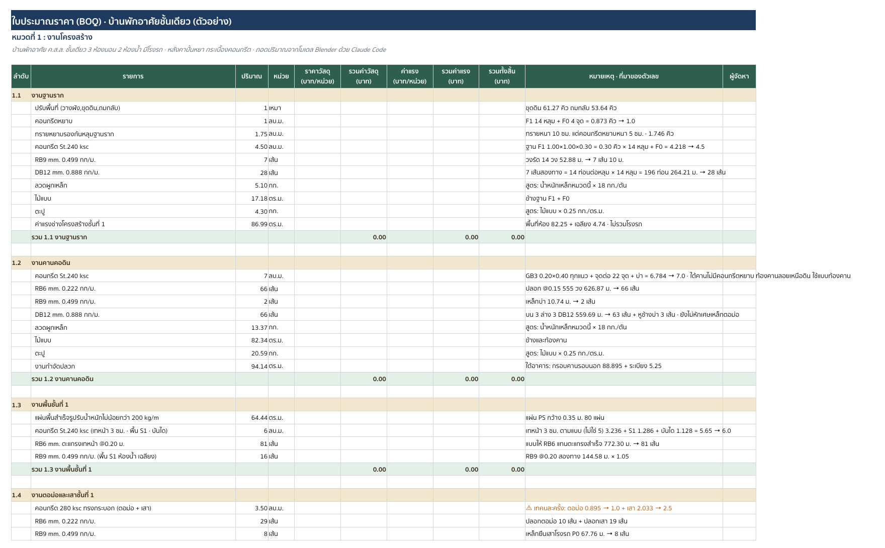
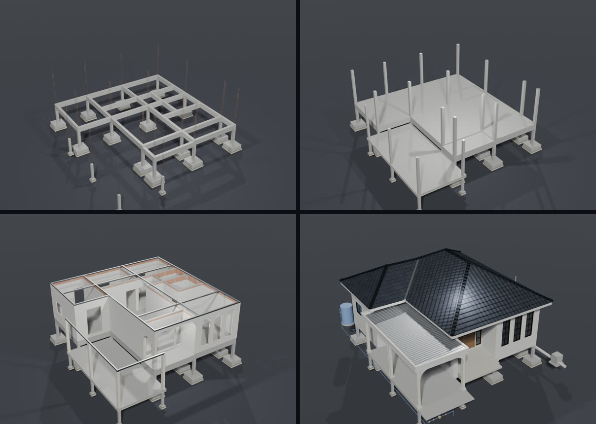
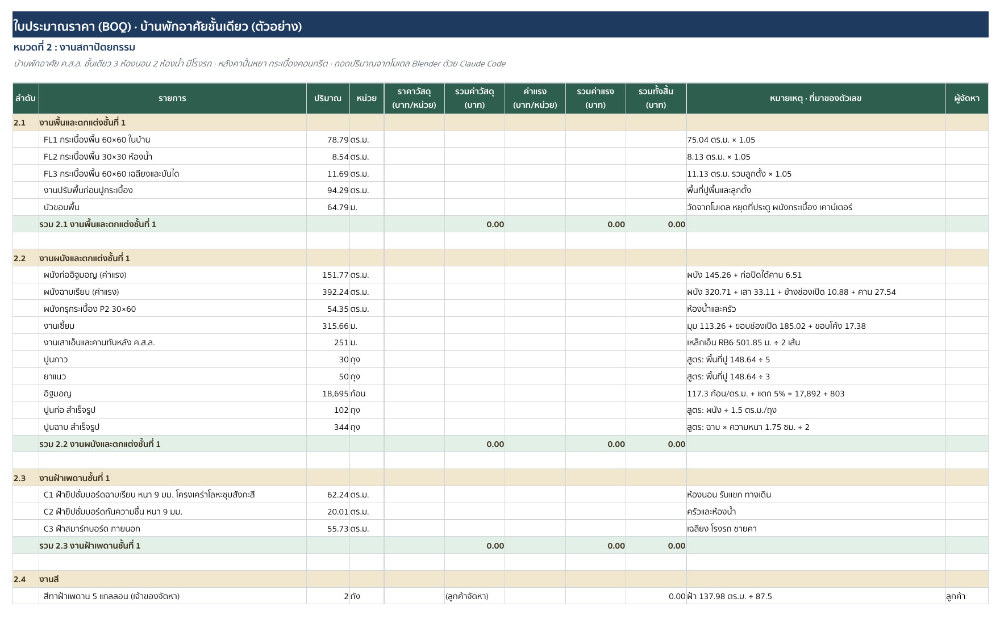
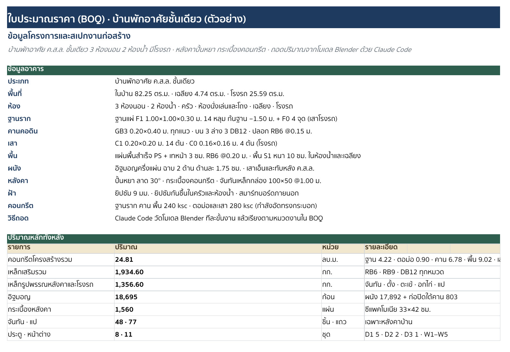

# nuea.ai BOQ Take-off · Skill ถอด BOQ จากโมเดล Blender ลง GridCraft หรือ Excel ด้วย Claude

> **For Claude and other AI agents:** to install this skill, follow [INSTALL.md](INSTALL.md)
> (raw: https://raw.githubusercontent.com/HaNorthRich/nuea-ai-boq-takeoff-skill/main/INSTALL.md).

<p align="center">
  
</p>

Skill ตัวนี้ผมทำขึ้นมาจากคลิป EP7 ครับ ซึ่งจะให้ Claude ถอดปริมาณงานของบ้านที่ปั้นไว้ใน Blender ทีละหมวดงานเหมือนสร้างจริง
ตั้งแต่ฐานราก ตอม่อ คานคอดิน พื้น ผนัง หลังคา ไปจนถึงงานสี ประตูหน้าต่าง สุขาภิบาล และไฟฟ้า
แล้วออกมาเป็นไฟล์ BOQ ที่**ทุกแถวบอกที่มาของตัวเลข** และมีสูตรรวมราคาให้พร้อม เปิดได้ทั้งใน GridCraft (โปรแกรมตารางคำนวณฟรี เปิดไฟล์ .xlsx ได้) และ Excel เลยครับ

> **อ่านก่อนใช้ · ข้อจำกัดความรับผิด**
> - Skill นี้เป็นเครื่องมือช่วยประมาณปริมาณงานและทำใบประมาณราคาเบื้องต้น แจกฟรีเพื่อการเรียนรู้ ไม่ใช่งานออกแบบ คำนวณ หรือตรวจสอบโครงสร้าง และไม่ใช่การรับรองโดยวิศวกร สถาปนิก หรือผู้ประมาณราคา
> - ตัวเลขทุกตัวมาจากโมเดลและข้อมูลที่คุณป้อน และประมวลผลโดย AI ซึ่งผิดพลาดได้ ทั้งปริมาณ หน่วย การปัดเศษ และราคา ต้องให้วิศวกรหรือผู้ประมาณราคา (QS) ตรวจก่อนสั่งของ เสนอราคา หรือเซ็นสัญญาทุกครั้ง
> - ขนาดชิ้นส่วนโครงสร้าง (ฐานราก เสา คาน เหล็กเสริม โครงหลังคา) ในไฟล์เป็นค่าที่อ่านจากโมเดลหรือแบบของคุณ Skill ไม่ได้ตรวจว่ารับน้ำหนักได้ งานก่อสร้างจริงต้องใช้ตามแบบที่วิศวกรลงนามเท่านั้น
> - ผู้จัดทำให้ใช้ "ตามสภาพ" ไม่มีการรับประกันใด ๆ และไม่รับผิดชอบต่อความเสียหายจากการนำผลลัพธ์ไปใช้ เช่น สั่งวัสดุขาดหรือเกิน ตั้งราคาผิด หรืองานล่าช้า เท่าที่กฎหมายอนุญาต รายละเอียดตาม [LICENSE](LICENSE)

หน้านี้ผมเขียนไว้ให้คนที่เพิ่งโหลด Skill ไปครับ ทำตามทีละขั้นได้เลย มีข้อความให้ก๊อปไปพิมพ์สั่ง Claude ทุกขั้น

<p align="center">
  
</p>

## ได้อะไรบ้าง

- **ไฟล์ `BOQ-<ชื่อบ้าน>.xlsx`** แยกชีตตามหมวดงาน: งานโครงสร้าง งานสถาปัตยกรรม งานสุขาภิบาล งานระบบไฟฟ้า
- **ทุกแถวมีที่มาของตัวเลข** เช่น `ฐาน F1 1.00×1.00×0.30 = 0.30 คิว × 14 หลุม = 4.218 → 4.5` จะได้ไล่ตรวจย้อนได้ครับ
- **สูตรพร้อมใช้** ใส่ราคาวัสดุกับค่าแรงต่อหน่วยลงไป ยอดรวมของแถว ของหมวด และของทั้งหลังจะคำนวณให้เอง
- **ชีตสรุปราคา** มีค่าดำเนินการ กำไร VAT ยอดรวมเป็นตัวอักษรไทย ราคาต่อตารางเมตร และกราฟสัดส่วนแต่ละหมวด
  (อัตราแก้ได้ในชีต · ใส่ VAT เฉพาะเมื่อผู้เสนอราคาจดทะเบียนภาษีมูลค่าเพิ่มแล้ว)
- **แถวที่ต้องยืนยัน** ขึ้นเครื่องหมาย ⚠ สีส้ม เช่น ขนาดจันทันที่ต้องให้วิศวกรดู หรือจุดที่แบบไม่ได้ระบุ
- **แม่แบบ BOQ เปล่า** ([`BOQ-template-blank.xlsx`](nuea-ai-boq-takeoff/examples/BOQ-template-blank.xlsx)) เอาไปกรอกเองก็ได้ครับ

<p align="center">
  
</p>

## ก่อนเริ่ม ต้องมีอะไรบ้าง

- **Blender** 4.2 ขึ้นไป ([โหลดฟรี](https://www.blender.org/download/))
- **Claude Code** ใช้กับแพ็กเกจเสียเงินของ Claude (Pro ขึ้นไป) หรือ API key แพ็กเกจฟรีใช้ไม่ได้ (ณ พ.ย. 2569 · [ดูแพ็กเกจ](https://claude.com/pricing))
  เปิดได้ทั้งในแอป Claude บนคอมพิวเตอร์ (แท็บ Code) และใน terminal
- **Python 3** ซึ่ง Mac กับ Linux ส่วนใหญ่มีมาให้แล้ว ส่วน Windows ตอนติดตั้ง Claude จะเช็กให้ครับ
- **ไฟล์ .blend ของบ้าน** ที่ปั้นด้วย Skill ปั้นบ้านใน Blender ของช่อง nuea.ai ยิ่งปั้นละเอียดก็ยิ่งถอดได้ละเอียด ถ้าปั้นถึงเหล็กเสริม Claude ก็นับให้ถึงเหล็ก
  ใครยังไม่มี Skill ปั้นบ้าน ดูวิธีรับในหัวข้อถัดไปครับ
- **โปรแกรมเปิดไฟล์ เลือก 1 อย่าง**
  - **GridCraft** ฟรี ลงได้ทั้ง Mac Windows และ Linux ([หน้าดาวน์โหลด](https://github.com/storytold/gridcraft/releases))
  - **Excel** หรือ LibreOffice หรืออัปโหลดขึ้น Google Sheets ก็ได้

## Skill นี้ต่อยอดจาก Skill ปั้นบ้านใน Blender

<p align="center">
  
</p>

Skill ถอด BOQ ตัวนี้ทำงานต่อจาก **Skill ปั้นบ้าน 3D ใน Blender แบบละเอียด** ของช่อง nuea.ai ครับ ซึ่งจะปั้นบ้านทีละขั้นตามลำดับก่อสร้างจริง
ตั้งแต่ฐานราก เหล็กเสริม ผนัง หลังคา ไปจนถึงท่อและสายไฟ และจดปริมาณของแต่ละขั้นเก็บไว้ข้างไฟล์โมเดล
Skill ถอด BOQ จะหยิบปริมาณพวกนั้นมาเรียงเป็นแถว BOQ ต่อได้เลย โมเดลที่ปั้นด้วย Skill นั้นจึงได้ BOQ ที่ละเอียดกว่า และ Claude ถามเราน้อยลงครับ

ถ้ายังไม่มี Skill ปั้นบ้าน รับได้ฟรีแบบนี้ครับ

1. กดติดตามช่อง **nuea.ai** (Instagram [@nuea.ai](https://www.instagram.com/nuea.ai/))
2. เข้าไปที่คลิป **EP4 "Claude ปั้นบ้านตั้งแต่ฐานรากยันหลังคา ใน Blender"** ในหน้าโปรไฟล์ของช่อง
3. คอมเมนต์คำว่า **Follow** ใต้คลิปนั้น
4. ผมจะส่งลิงก์ Skill ให้ทาง DM ครับ ลิงก์จะมาจากบัญชี @nuea.ai เท่านั้น และชี้ไปที่ `github.com/HaNorthRich/…` เท่านั้น ถ้าได้ลิงก์จากบัญชีอื่นหรือไปเว็บอื่น อย่ากดนะครับ

มีโมเดลบ้านที่ปั้นด้วยวิธีอื่นอยู่แล้วก็ใช้ Skill ถอด BOQ ได้ครับ แต่ส่วนที่โมเดลไม่ได้ปั้นไว้ Claude จะต้องประมาณและถามเรามากขึ้น

## ขั้นที่ 0 · ติดตั้ง (ให้ Claude ลงให้)

1. ลง Blender และเปิด Claude Code
2. ส่งข้อความนี้ให้ Claude

   ```
   ลง Skill นี้ให้หน่อย https://github.com/HaNorthRich/nuea-ai-boq-takeoff-skill
   ```

3. Claude จะเช็ก Blender กับ Python ลง Skill แล้วถามว่าจะเปิดไฟล์ด้วยโปรแกรมอะไร ตามขั้นตอนใน [INSTALL.md](INSTALL.md)
   ในโหมดปกติ Claude Code จะขอให้เรากดอนุญาตก่อนรันแต่ละคำสั่งครับ อ่านคำสั่งก่อนกด Allow ทุกครั้งนะครับ
4. ตอนจบ Claude จะทดสอบด้วยบ้านตัวอย่าง (ประมาณ 30 วินาทีบนเครื่องที่ผมทดสอบ) ได้ไฟล์ `BOQ-ep7-house.xlsx` มาลองเปิดดู
5. **ปิด Claude Code ให้สนิทแล้วเปิดใหม่** เพราะ Skill จะโหลดตอนเปิด session ใหม่เท่านั้นครับ

## ใช้งานทีละขั้น

ทุกอย่างที่ Skill ทำจะอยู่ในโฟลเดอร์ `boq/` ข้างไฟล์ .blend ของคุณ สคริปต์วัดโมเดลเปิดไฟล์ .blend แบบอ่านอย่างเดียว ไม่เซฟทับ แต่ควรสำรองไฟล์ไว้ก่อนเสมอ
และให้เซฟงานใน Blender ก่อนสั่งนะครับ เพราะ Claude จะอ่านจากไฟล์ที่เซฟไว้

### ขั้นที่ 1 · บอก Claude ว่าจะถอดบ้านหลังไหน

```
ถอด BOQ บ้านหลังนี้ให้หน่อย <path ของไฟล์ .blend>
```

Claude จะถามเราไม่กี่เรื่องครับ

- มีแบบก่อสร้าง (PDF) ไหม ถ้ามี Claude จะยึดแบบเป็นหลัก แล้วใช้โมเดลเติมส่วนที่แบบไม่ได้บอก
- ชื่อโครงการ และพื้นที่ใช้สอย (ถ้ารู้)
- ราคาจะเอามาจากไหน: รายการราคาของเราเอง เว็บร้านวัสดุที่เราบอก หรือเว้นว่างไว้ก่อน

### ขั้นที่ 2 · Claude วัดโมเดล

Claude จะเปิดไฟล์ด้วย Blender แบบไม่มีหน้าต่าง แล้ววัดทุกชิ้นในโมเดล: พื้นที่ผนังสุทธิที่หักช่องเปิดแล้ว ขนาดประตูหน้าต่าง
ผืนหลังคา ความยาวสัน ตะเข้ ชายคา เหล็กแยกตามหน้าตัด ปริมาตรคอนกรีต และจำนวนชิ้น บนเครื่องที่ผมทดสอบใช้เวลาไม่ถึงนาทีครับ
ผลวัดจะอยู่ใน `boq/takeoff.md` เปิดอ่านได้

### ขั้นที่ 3 · เรียงเป็นแถว BOQ

Claude จะไล่ทีละหมวดงานตามลำดับก่อสร้าง แล้วเขียนแต่ละแถวพร้อมวิธีคิด เช่น คอนกรีตปัดขึ้นทีละครึ่งคิว เหล็กเส้นคิดเป็นเส้น 10 เมตร
รวมระยะทาบ อิฐเผื่อแตก 5% ถ้าอยากให้คิดต่างจากนี้ บอกได้เลยครับ

```
เหล็กเสริมเผื่อ 15% แทน 10% และกระเบื้องพื้นเผื่อ 7%
```

ตอนจบขั้นนี้ Claude จะบอกเรา 2 รายการ คือ **แถวที่ตั้งใจไม่ใส่** พร้อมเหตุผล และ **ของที่มีในโมเดลแต่ยังไม่มีแถว** ให้เราตัดสินครับ

### ขั้นที่ 4 · ใส่ราคา

Skill นี้**สั่งให้ Claude ไม่เดาราคา**ครับ ให้ใส่ราคาเฉพาะจากแหล่งที่เราให้ แล้วจดไว้ในหมายเหตุของแถวว่ามาจากไหน วันที่เท่าไหร่
แต่ AI พลาดได้ ตรวจราคากับแหล่งจริงอีกครั้งก่อนใช้นะครับ

```
ใช้ราคาจากไฟล์นี้ <path ของไฟล์ราคา .xlsx หรือ .csv>
```

แถวไหนยังไม่มีราคาก็เว้นว่างได้ ชีตสรุปราคาจะบอกว่ายังขาดกี่รายการ และเราพิมพ์ราคาลงในคอลัมน์ E กับ G ทีหลังได้เลยครับ

### ขั้นที่ 5 · ได้ไฟล์ BOQ

Claude จะสร้างไฟล์ `boq/BOQ-<ชื่อบ้าน>.xlsx` แล้วเทียบยอดรวมในไฟล์กับยอดที่คิดแยกไว้อีกทาง เพื่อเช็กว่าสูตรในไฟล์รวมเลขถูก
(ขั้นนี้ตรวจการบวกคูณ ไม่ได้ยืนยันว่าปริมาณหรือราคาถูกต้อง)
จากนั้นสรุปให้ว่ามีกี่แถว ยอดรวมเท่าไหร่ แถวไหนต้องยืนยัน และอะไรที่ไม่รวมอยู่ในงาน

<p align="center">
  
</p>

## เปิดใน GridCraft หรือ Excel

| โปรแกรม | ทำยังไง | หมายเหตุ |
|---|---|---|
| **GridCraft** | เปิดไฟล์ `.xlsx` ได้เลย | ฟรี · ยอดรวมเป็นตัวอักษรไทย (BAHTTEXT) คำนวณได้ |
| **Excel** | เปิดไฟล์ `.xlsx` ได้เลย | สูตรที่ใช้เป็นสูตรพื้นฐานของ Excel ทั้งหมด · ผมยังไม่ได้ลองเปิดใน Excel เอง |
| **Google Sheets** | อัปโหลดไฟล์แล้วเปิดด้วย Google Sheets | |
| **LibreOffice** | เปิดไฟล์ `.xlsx` ได้เลย | ช่องยอดรวมเป็นตัวอักษรจะขึ้น `#NAME?` ยอดอื่นคำนวณได้ตามปกติ |

ถ้าอยากให้ **GridCraft เป็นคนเขียนไฟล์เอง** (ไม่ต้องลง openpyxl) ให้ลง `gridcraft-cli` จากหน้าดาวน์โหลดเดียวกัน แล้วบอก Claude ว่า

```
สร้างไฟล์ BOQ ด้วย gridcraft-cli ให้หน่อย
```

Claude จะแปลงแถว BOQ เป็นชุดคำสั่งของ GridCraft แล้วให้ GridCraft รันเองครับ
ส่วนการให้ Claude เติมแถวลงหน้าต่าง GridCraft ที่เปิดอยู่แบบในคลิป ทำผ่าน MCP ของ GridCraft ได้ แต่ยังเป็นขั้นทดลอง วิธีต่ออยู่ใน
[SKILL.md](nuea-ai-boq-takeoff/SKILL.md) ขั้นที่ 5

## บ้านตัวอย่างจากคลิป EP7

ในโฟลเดอร์ [`examples/`](nuea-ai-boq-takeoff/examples) มี BOQ ของบ้านชั้นเดียว 3 ห้องนอน 2 ห้องน้ำ หลังเดียวกับในคลิป ทั้งหมด 153 แถว
ผมเว้นราคาไว้ให้ใส่เองครับ ปริมาณในตัวอย่างมีไว้สาธิตเท่านั้น ห้ามนำไปใช้ก่อสร้างจริง ส่วนชื่อยี่ห้อวัสดุเป็นตัวอย่างสเปก เลือกยี่ห้ออื่นที่เทียบเท่าได้

| รายการ | ปริมาณ |
|---|---|
| คอนกรีตโครงสร้างรวม | 24.81 ลบ.ม. |
| เหล็กเสริมรวม | 1,934.60 กก. |
| ฐานราก | 14 หลุม หลุมละ 0.30 ลบ.ม. |
| อิฐมอญ | 18,695 ก้อน |
| กระเบื้องหลังคา | 1,560 แผ่น |
| ประตู · หน้าต่าง | 8 · 11 ชุด |
| จุดไฟฟ้า | โคม 31 · สวิตช์ 10 · เต้ารับ 15 |

<p align="center">
  
</p>

## ไฟล์ปริมาณหน้าตาเป็นยังไง

ระหว่างทาง Claude จะเก็บแถว BOQ ไว้ในไฟล์ `boq/<ชื่อบ้าน>_qty.json` ซึ่งเราเปิดแก้เองได้ครับ หนึ่งแถวคือ
`[รายการ, ปริมาณ, หน่วย, ราคาวัสดุ, ค่าแรง, หมายเหตุ]`

```json
["คอนกรีต St.240 ksc", 4.5, "ลบ.ม.", null, null, "ฐาน F1 1.00×1.00×0.30 = 0.30 คิว × 14 หลุม + F0 = 4.218 → 4.5"]
```

แก้ตัวเลขแล้วสั่ง `สร้างไฟล์ BOQ ใหม่จากไฟล์ปริมาณ` ก็ได้ไฟล์ใหม่ทันที รูปแบบทั้งหมดอยู่ใน
[qty-format.md](nuea-ai-boq-takeoff/references/qty-format.md) และกติกาการถอดแต่ละหมวดอยู่ใน
[takeoff-rules.md](nuea-ai-boq-takeoff/references/takeoff-rules.md)

## ข้อจำกัดที่ควรรู้

- **ปริมาณเป็นค่าประมาณสำหรับตั้งราคา** ดู "อ่านก่อนใช้" ด้านบน โดยเฉพาะขนาดโครงหลังคาและเหล็กเสริม
- **ถอดได้เท่าที่ปั้นไว้** โมเดลที่ไม่มีท่อ ไม่มีสายไฟ Claude จะประมาณจากผังและขึ้น ⚠ ให้ทุกแถว
- **ชื่อชิ้นงานในโมเดล** Skill รู้จักชื่อและไฟล์ปริมาณรายขั้นของ Skill ปั้นบ้านของช่อง nuea.ai โมเดลที่ตั้งชื่อแบบอื่นก็ใช้ได้ แต่ Claude จะต้องไล่ถามเราว่าชิ้นไหนคืออะไรมากขึ้น
- **พิมพ์เป็น PDF** ตอนที่ผมลอง (GridCraft 0.17.0) ภาษาไทยใน PDF ยังไม่ขึ้น ถ้าจะพิมพ์ ให้เปิดไฟล์เดียวกันใน Excel หรือ Google Sheets ครับ
- **Excel** ผมตรวจสูตรทั้งไฟล์ด้วย LibreOffice แล้วยอดรวมตรงกับที่คิดแยกไว้ แต่ยังไม่ได้ลองเปิดใน Excel เอง ถ้าเจออะไรแปลก แจ้งที่ Issues ได้เลยครับ

## ปัญหาที่เจอบ่อย

| อาการ | แก้ยังไง |
|---|---|
| Claude บอกว่าไม่รู้จัก Skill | ปิด Claude Code ให้สนิทแล้วเปิดใหม่ |
| ตัวเลขไม่ตรงกับที่เพิ่งแก้ใน Blender | เซฟไฟล์ใน Blender ก่อน แล้วสั่งถอดใหม่ Claude อ่านจากไฟล์ที่เซฟไว้ |
| ยอดรวมเป็น 0 | ยังไม่ได้ใส่ราคา พิมพ์ราคาต่อหน่วยในคอลัมน์ E (วัสดุ) และ G (ค่าแรง) |
| `build_boq: … ต้องมี 4 หมวดงาน` หรือข้อความคล้ายกัน | ไฟล์ปริมาณผิดรูปแบบ ข้อความจะบอกแถวและกติกาที่ผิด ให้ Claude แก้ไฟล์ปริมาณ |
| ภาษาไทยลอยไม่ตรงบรรทัดใน GridCraft | เลือกทั้งชีตแล้วเปลี่ยนฟอนต์เป็นฟอนต์ไทยในเครื่อง เช่น Sukhumvit Set หรือ Leelawadee UI |
| `openpyxl` ลงไม่ได้ | ใช้ทาง `gridcraft-cli` แทน (ดูหัวข้อ "เปิดใน GridCraft หรือ Excel") |

## ไฟล์ใน repo

```
nuea-ai-boq-takeoff/          ตัว Skill (โฟลเดอร์นี้คือสิ่งที่ลงใน ~/.claude/skills)
  SKILL.md                    ขั้นตอนที่ Claude ทำตาม
  scripts/blend_takeoff.py    วัดโมเดล .blend แบบอ่านอย่างเดียว
  scripts/build_boq.py        ไฟล์ปริมาณ → BOQ.xlsx หรือชุดคำสั่ง GridCraft
  references/                 กติกาการถอด และรูปแบบไฟล์ปริมาณ
  examples/                   บ้านตัวอย่าง 153 แถว + แม่แบบเปล่า
INSTALL.md                    ขั้นตอนติดตั้งสำหรับ Claude
docs/images/                  รูปในหน้านี้
```

## ชื่อและเครื่องหมายการค้า

ชื่อ Blender, Claude, Claude Code, GridCraft, Microsoft Excel, Google Sheets, LibreOffice และชื่อยี่ห้อวัสดุในไฟล์ตัวอย่าง เป็นชื่อทางการค้าหรือเครื่องหมายการค้าของเจ้าของแต่ละราย ใช้เพื่อบอกว่า Skill ทำงานร่วมกับอะไรและเป็นตัวอย่างสเปกวัสดุเท่านั้น โปรเจกต์นี้ทำโดย nuea.ai เอง ไม่ได้เป็นส่วนหนึ่งของ และไม่ได้รับการรับรองจากเจ้าของชื่อเหล่านั้น

## License

[MIT](LICENSE) ใช้ แก้ และแจกต่อได้ครับ โดยคงข้อความลิขสิทธิ์และข้อความอนุญาตไว้ · ให้ใช้ตามสภาพ ไม่มีการรับประกัน · ทำโดย [nuea.ai](https://github.com/HaNorthRich)
